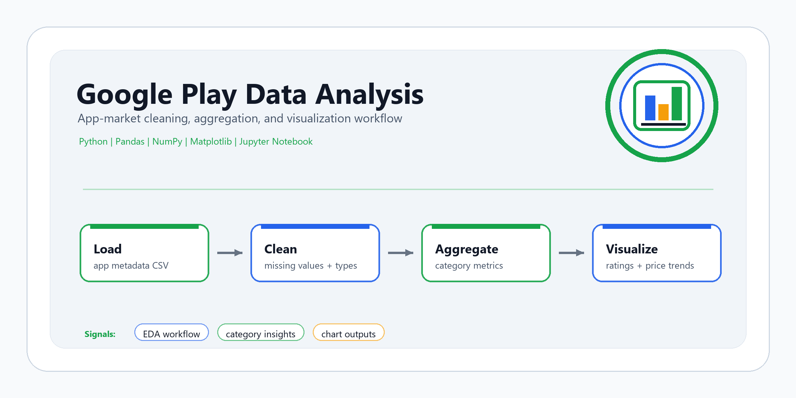
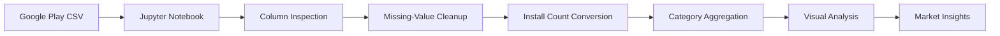
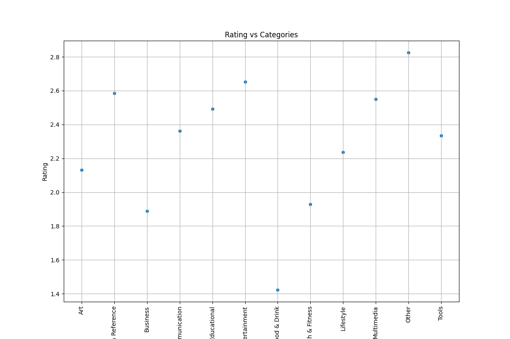
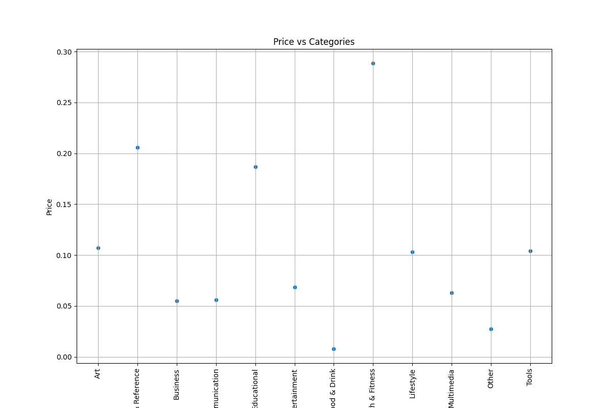

# Google Play Data Analysis

**Exploratory data analysis project for Google Play Store app metadata using Python, Pandas, NumPy, Matplotlib, and Jupyter Notebook.**

[GitHub profile](https://github.com/sntk-76)

## Overview

Google Play Data Analysis explores app-market metadata from the Google Play Store to understand how categories, ratings, installs, pricing, free/paid status, and currencies vary across applications.

The project demonstrates a practical analytics workflow: loading a raw app metadata dataset, selecting business-relevant fields, handling missing values, converting string-based metrics into numeric values, aggregating category-level statistics, and visualizing patterns with Matplotlib.

## Why This Project Matters

App-store datasets are useful for market analysis because they combine product metadata, user ratings, install behavior, pricing strategy, content ratings, developer information, and monetization signals. Cleaning this kind of dataset requires careful type handling because fields such as installs and prices often arrive as strings or mixed formats.

For recruiters and technical reviewers, this repository shows core data analysis skills: data inspection, preprocessing, type conversion, feature selection, grouped aggregation, descriptive statistics, and visual storytelling.

## Core Capabilities

| Capability | Implementation |
| --- | --- |
| Dataset inspection | Reviews Google Play Store metadata columns and data types in Jupyter. |
| Field selection | Focuses analysis on category, rating, installs, price, free/paid status, and currency. |
| Missing-value handling | Drops incomplete rows before calculating descriptive and grouped statistics. |
| Type conversion | Converts install counts from string format into numeric values for analysis. |
| Category aggregation | Computes category-level averages for rating, installs, and price. |
| Market segmentation | Compares free vs. paid apps and currency distribution. |
| Visualization | Produces Matplotlib charts for rating/category and price/category relationships. |

## Analysis Workflow



## Technical Stack

| Layer | Tools |
| --- | --- |
| Language | Python |
| Notebook environment | Jupyter Notebook |
| Data handling | Pandas, NumPy |
| Visualization | Matplotlib |
| Output artifacts | PNG chart exports |

## Repository Structure

```text
google-play-data-analysis/
|-- assets/
|   `-- google-play-data-analysis-cover.png
|-- google play apps.ipynb        # Main exploratory analysis notebook
|-- rating_vs_category.png        # Exported rating/category visualization
|-- price_vs_category.png         # Exported price/category visualization
|-- requirements.txt
|-- LICENSE
`-- README.md
```

## Dataset

The analysis expects a Google Play Store metadata CSV with fields such as:

- App name and app ID
- Category
- Rating and rating count
- Installs, minimum installs, and maximum installs
- Free/paid flag
- Price and currency
- App size and minimum Android version
- Developer metadata
- Release and update dates
- Content rating
- Ad support, in-app purchases, and editor choice flags

The CSV is not committed in this repository. To reproduce the notebook, download a compatible Google Play Store dataset and update the `pd.read_csv(...)` path in `google play apps.ipynb`.

## Preprocessing Steps

The notebook performs the following preparation steps:

1. Loads the Google Play Store CSV into a Pandas DataFrame.
2. Reviews available columns and initial dataset structure.
3. Creates focused numerical and categorical DataFrames.
4. Drops rows with missing values before analysis.
5. Converts the `Installs` column from string format into a numeric field.
6. Generates descriptive statistics for numerical and categorical subsets.
7. Aggregates rating, installs, and price metrics by app category.

## Visual Analysis

The notebook explores:

- Average rating by app category.
- Average installs by app category.
- Average price by app category.
- Free vs. paid app distribution.
- Currency distribution.
- Rating vs. price relationship.
- Installs vs. price relationship.

### Example Outputs





## Running Locally

```bash
git clone https://github.com/sntk-76/google-play-data-analysis.git
cd google-play-data-analysis

python -m venv .venv
.venv\Scripts\activate
pip install -r requirements.txt
```

On macOS/Linux, activate the environment with:

```bash
source .venv/bin/activate
```

Then open the notebook:

```bash
jupyter notebook "google play apps.ipynb"
```

Before running all cells, place the dataset locally and update the notebook's CSV path.

## Project Highlights

- Demonstrates a complete exploratory data analysis workflow from raw app metadata to visual outputs.
- Handles real-world data preparation issues such as missing values and numeric conversion from string fields.
- Uses category-level aggregation to make app-market behavior easier to compare.
- Produces simple, interpretable charts for rating and price analysis.
- Keeps the project lightweight and easy to reproduce with standard Python analytics libraries.

## Future Improvements

- Move notebook logic into a reusable Python analysis script.
- Add a `data/` folder convention with clear instructions for expected CSV naming.
- Add richer visualizations for installs, content ratings, monetization, and category share.
- Add correlation analysis between installs, price, ratings, and rating count.
- Build an interactive dashboard with Streamlit or Plotly.

## License

This project is licensed under the [MIT License](LICENSE).
